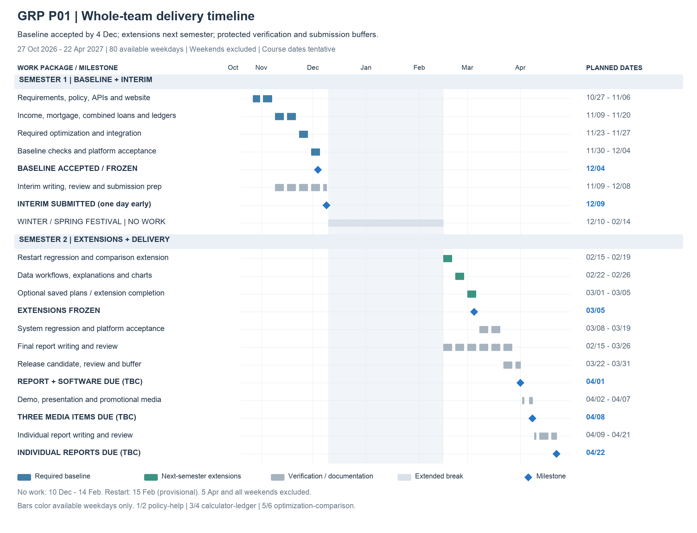

# GRP P01 — Team Responsibilities and Delivery Plan

**Project:** Mortgage and Income Tax Joint Calculator  
**Planning date:** 25 October 2026 · **Start:** Tuesday, 27 October 2026  
**Team:** Six members, identified by number so responsibilities can be assigned later.  
**Delivery approach:** Accept and freeze all required baseline functions by 4 December 2026; submit the interim report on 9 December; develop extensions from 15 February 2027, with a feature freeze on 5 March.

This plan uses the existing local prototype as its starting point. Members should understand, review, improve and test existing code before replacing it. The agreed structure is five functional pages and a shared plan-details window. The calculator, recommendations and comparison plans open income, cash-flow and repayment ledgers in this window without changing the underlying page or draft.

This document replaces the scheduling and staffing assumptions in the earlier four-person roadmap. All future activities below are planned work, not claims of completed contributions.

## 1. Responsibilities by team member

| Member | Roles | Assigned pages | Specific responsibilities |
|---|---|---|---|
| **1** | Project Manager + Business Analyst + Supporting Backend Developer | Policies & Methodology; Help & Project Information | Review progress and deliverables, requirement coverage, report/software consistency and corrections. With 2, verify policy sources and business rules. Develop policy/example interfaces and assist backend validation. Each member writes their own report section. |
| **2** | Frontend Engineer + UI Designer + Business Analyst | Policies & Methodology; Help & Project Information | With 1, interpret Chinese policies and define business requirements. Build the two content pages using React, TypeScript and Ant Design; maintain bilingual guidance, examples and course project information. |
| **3** | Backend Engineer | Homepage / Joint Calculator; Shared Plan Details | Own Java/BigDecimal tax, provident-fund, mortgage and cash-flow calculations, full schedules, calculation APIs and JUnit checks. Support data workflows and shared financial-rule verification. |
| **4** | Frontend Engineer + UI Designer | Homepage / Joint Calculator; Shared Plan Details | Build inputs, results, ledgers and repayment charts; lead shared navigation, layout and components. Own ledger exports and scenario import/export interactions with 3. |
| **5** | Backend Engineer | Plan Optimization; Condition Comparison | Own bounded search, constraints, ranking and comparison APIs, reusing 3's engine. Maintain PostgreSQL integration, Docker, CI and integration checks. Add optional saved scenarios only after committed features pass. |
| **6** | Frontend Engineer + UI Designer | Plan Optimization; Condition Comparison | Build search controls, recommendations, baseline comparisons and applying a plan. Extend condition-comparison charts and explanations next semester; optional saved-scenario controls with 5. |

Members 1/2 share business analysis; 1/3/5 contribute backend work; 2/4/6 share frontend and UI. Members 3/5 cross-review backend logic; 2/4/6 review frontend changes. Each member owns module tests, documentation and their own report section. Member 1's management duties emphasize review, consistency checks and verification of corrections.

## 2. Responsibilities by functional page

| Page | Frontend / UI | Backend | Function and delivery stage |
|---|---|---|---|
| Policies & Methodology | **2** | **1** | Baseline: dated sources, supported scope, formulas and assumptions. Next semester: improve version traceability and explanations. Policy content jointly checked by 1/2. |
| Help & Project Information | **2** | **1** | Baseline: working examples, guide, FAQ and course project information. Next semester: document added workflows and improve bilingual guidance. |
| Homepage / Joint Calculator | **4** | **3** | Baseline: salary/tax/provident-fund inputs, both repayment methods, combined loans, monthly/annual income and disposable cash. |
| Shared Plan Details (shared window, not a page) | **4** | **3** | Baseline: annual ledger and complete repayment schedule reconciled with homepage totals. Next semester: polished CSV exports and JSON round trips. |
| Plan Optimization | **6** | **5** | Baseline: bounded constrained search, ranking, comparison with original plan, applying a plan and no-feasible-plan handling. Next semester: richer explanations and trade-off charts. |
| Condition Comparison | **6** | **5** | Next-semester extension focus: a separate page changes one input against a fixed baseline and compares payments, interest and cash flow. |

The final target is five functional pages and a shared details window; the calculator is the homepage. The baseline includes the five required-flow/content pages and basic charts. The standalone condition-comparison extension is not required to pass interim acceptance. Existing working comparison features may be retained, but do not displace baseline delivery.

**Stack:** React + TypeScript + Ant Design + ECharts; Java + Spring Boot; an independent BigDecimal engine; PostgreSQL with the existing H2 local option; JUnit, Spring Boot integration checks, Playwright; Docker and GitHub Actions.

**Semester 1 — baseline accepted by 4 December:** salary/tax/provident fund, commercial/provident-fund/combined loans, both repayment methods, monthly/annual cash flow, full schedules, constrained optimization, baseline comparison, policy/help, bilingual responsive interface, local startup and actual desktop/mobile acceptance. Required optimization is completed before interim submission.

**Semester 2 — extensions frozen by 5 March:** standalone condition comparison, more useful explanations/charts, reliable CSV/JSON workflows, improved policy traceability and guidance. Named PostgreSQL scenarios are optional and dropped if unfinished by the freeze. No additional cities, authentication or live bank feeds are committed.

Existing prototype features are reused, reviewed and verified. The work is engineering delivery and validation. Final-report drafting runs alongside second-semester work; individual contributions remain each member's responsibility.

## 3. Working calendar and submission assumptions

- Work starts on **Tuesday, 27 October 2026**. All dates use **Asia/Shanghai**. Every Saturday and Sunday is excluded, including national make-up working weekends.
- The interim report is submitted on **Wednesday, 9 December 2026**, one day before the attachment's tentative 10 December deadline. This avoids assigning any upload or administrative task during the break; if the submission system is not open early, Member 1 must arrange an accepted submission route before the break.
- **No project work, meetings, reviews or report writing from 10 December 2026 through 14 February 2027 inclusive.** This is the team's requested extended break, not a claim about the statutory holiday period.
- Resume on **Monday, 15 February 2027**, provisionally after Spring Festival. The full 2027 State Council holiday arrangement was not located in the planning-date check. CFETS' provisional calendar lists Spring Festival on 5–12 February and Qingming on 5 April, explicitly subject to later adjustment. The restart date is therefore a planning assumption. [CFETS provisional calendar](https://www.chinamoney.org.cn/chinese/bbjjr/20251219/3254570.html)
- **Monday, 5 April 2027 is excluded** for Qingming; 3–4 April are already excluded weekends. New Year's Day and the provisional Spring Festival period fall inside the extended break. The 2026 national holidays listed in the official notice precede this project's start. [2026 State Council holiday notice](https://big5.www.gov.cn/gate/big5/www.gov.cn/zhengce/content/202511/content_7047090.htm)
- Member 1, with Member 2 checking, updates this calendar when official 2027 arrangements and the university calendar are confirmed. Any additional holiday weekdays are removed; optional work is reduced before deadlines or weekends are used.
- The course attachment labels its dates **TENTATIVE/TBC**. Planning targets are: ethics forms **28 October 2026, 15:00**; project website **5 November 2026, 15:00**; team report/software **1 April 2027, 15:00**; demo recording, presentation recording and promotional digital artefact **8 April 2027, 15:00**; individual reports **22 April 2027, 15:00**. Member 1 confirms these with the course team. Internal targets precede the major final deadlines.
- Open Day and the one-minute introduction/live Q&A have **no confirmed date** in the attachment. Prepare reusable materials in April; add attendance only after a date is confirmed. Equipment requests are handled at kickoff if needed; the project-bid milestone is outside this plan.

Workday counts below are inclusive calendar availability, **not full-time effort estimates or person-days**. A suggested term-time budget is 8 hours per member per full working week: 6 hours of assigned work and 2 hours for review, integration and contingency, adjusted proportionally for short weeks. This is a planning assumption for the team to confirm; all six members have zero scheduled hours during the break.

## 4. Detailed delivery timeline

<!-- TIMELINE_TABLE -->

| Phase | Start | End | Workdays | Owners | Tasks | Acceptance |
|---|---|---|---:|---|---|---|
| 01. **Kickoff, requirements and policy scope** | 2026-10-27 | 2026-10-30 | 4 | All; 1/2 review requirements | Run the prototype on every member’s machine. 1/2 confirm policy scope and sources; 3/5 agree calculation contracts; 2/4/6 agree page layouts. Check the tentative 28 Oct ethics requirement. | Runnable baseline, requirement list, ownership and policy register. |
| 02. **Data models, API contracts and project website** | 2026-11-02 | 2026-11-06 | 5 | 1/2 policy-help; 3/4 calculator; 5/6 optimization | 1 builds policy/example data; 2 drafts content pages; 3 defines calculation models; 4 builds forms/navigation; 5/6 connect the optimization view using mock responses. Meet the 5 Nov project website target; start requirements/design documentation. | API examples, page shell, project website and requirement traceability. |
| 03. **Income, tax and provident-fund baseline** | 2026-11-09 | 2026-11-13 | 5 | 3/4 lead; 1/2 review; 5/6 build in parallel | 3 implements/reviews income, bonus, deductions, insurance and provident fund; 4 connects results; 1/2 provide sources and reference cases; 5/6 build candidate generation and controls. Each member drafts their interim section. | Working income flow, reference/boundary checks and draft design sections. |
| 04. **Mortgage, combined loans and ledgers** | 2026-11-16 | 2026-11-20 | 5 | 3/4 lead; 5 cross-checks; 1/2 policy | 3/4 connect both repayment methods, combined loans, annual cash flow and full schedules; 5 reuses the engine for constraints; 6 displays candidate results; 1/2 complete baseline policies/help. | Repayment methods and combined loans work; homepage and ledgers reconcile; guidance is available. |
| 05. **Baseline optimization and end-to-end integration** | 2026-11-23 | 2026-11-27 | 5 | 5/6 lead; 3/4 integrate; 1/2 check rules | Complete bounded search over permitted terms/loan splits, feasibility filtering, ranking, baseline comparison and applying a plan. Explain infeasible cases and verify the full input-calculation-recommendation-ledger journey. | Required optimization works; small candidate sets have independently checked expected results; selected plans reproduce. |
| 06. **Baseline acceptance and interim review** | 2026-11-30 | 2026-12-04 | 5 | All; 1 reviews; 3/5 backend; 2/4/6 frontend | Accept all mandatory features, bilingual UI, local startup and actual desktop/mobile use. Regress financial/API/UI flows and fix blockers. Everyone completes their section; 1 checks the report, screenshots and software version. | Baseline accepted/frozen by 4 Dec; complete interim draft and actual test evidence. |
| 07. **Interim finalization, submission and archive** | 2026-12-07 | 2026-12-09 | 3 | All prepare materials; 1 reviews consistency | Use the buffer for necessary fixes, references and formatting. Submit the interim report on 9 Dec and retain the receipt; archive the baseline, examples, tests and restart notes. Confirm early submission access beforehand. | Interim submitted; baseline archived; no submission duties left for the break. |
| 08. **Extended winter / Spring Festival break** | 2026-12-10 | 2027-02-14 | 0 | All on break | No development, meetings, reviews, reports or submissions. Provisional restart: 15 Feb. | Zero workday capacity and no dependency on holiday work. |
| 09. **Restart checks and condition-comparison extension** | 2027-02-15 | 2027-02-19 | 5 | 1/2 review; 3/4 regress; 5/6 extend | Restore/regress the accepted baseline; check policy, calendar and deadlines. 5/6 extend the standalone condition-comparison page with a fixed baseline and one changed input. Start final-report updates; mandatory features were completed before interim. | Baseline regression passes; first comparison extension is demonstrable; extension scope confirmed. |
| 10. **Import/export, explanations and chart extensions** | 2027-02-22 | 2027-02-26 | 5 | 3/4 data workflows; 5/6 explanations; 1/2 guidance | 3/4 improve CSV ledger exports and JSON scenario round trips; 5/6 improve recommendation differences, comparison charts and infeasibility messages; 1/2 update policy traceability and help examples. | Exports reconcile, imports recalculate, charts match source data; all five pages and the shared details window connected. |
| 11. **Extension completion and feature freeze** | 2027-03-01 | 2027-03-05 | 5 | All; 5/6 optional storage; 1/2 content; 3/4 stability | Only after prior checks pass, consider named PostgreSQL scenarios: 5/6 implement, 3/4 supply data, 1 assists. Finish bilingual/mobile guidance. Freeze scope on 5 Mar; drop incomplete optional items. | Extensions frozen; optional persistence explicitly included or dropped; subsequent work is validation/fixes. |
| 12. **System integration and regression** | 2027-03-08 | 2027-03-12 | 5 | 3/5 backend; 2/4/6 frontend; 1 checks coverage | Run JUnit, Spring Boot integration tests and critical Playwright flows; check invalid inputs, infeasible cases, languages and data workflows. Verify actual database/Docker/CI behavior. | Requirement-test traceability, actual results and defect/fix records. |
| 13. **Cross-platform acceptance and final draft** | 2027-03-15 | 2027-03-19 | 5 | Each member writes their section; 1 reviews | Complete actual desktop/mobile user journeys and fix usability defects. Finish requirements, design, implementation, tests, limitations and contribution sections. 1 checks report/software consistency. | Actual platform acceptance and a complete final-report draft by 19 Mar. |
| 14. **Release candidate, report review and media preparation** | 2027-03-22 | 2027-03-26 | 5 | 3/5 release; 2/4/6 media; 1 reviews | Verify clean setup, regress key calculations and check citations, manuals and contribution records. Prepare demo scripts, slides and promotional drafts. Freeze the release candidate on 26 Mar. | Runnable candidate, reviewed report and draft media; critical defects closed. |
| 15. **Final checks and submission buffer** | 2027-03-29 | 2027-03-31 | 3 | All; 1 checks the delivery list | Reserve three days for necessary rework, packaging, formatting and upload checks. Internal target: submit report/software by 31 Mar, or have the full package ready if the portal is not open. | Consistent software/report/configuration/evidence; receipt or complete ready-to-upload package. |
| 16. **Team report and software deadline** | 2027-04-01 | 2027-04-01 | 1 | All; 1 verifies completion | Submit or verify before 15:00; check downloaded files and retain receipts. Course date remains tentative. | Report and software submission complete. |
| 17. **Demo and team presentation recording** | 2027-04-02 | 2027-04-02 | 1 | All; 2/4/6 visuals; 3/5 walkthrough; 1 reviews | Record the submitted software using prepared scripts; build the promotional artefact; no new software features. | Draft demo/presentation recordings and promotional artefact. |
| 18. **Media checks and early submission** | 2027-04-06 | 2027-04-07 | 2 | All; 1 reviews completeness | No work on 3–5 Apr. From 6 Apr check audio, captions, duration, playback and links; target submission of all three items on 7 Apr. | All three media deliverables checked and ready/submitted. |
| 19. **Media submission deadline** | 2027-04-08 | 2027-04-08 | 1 | All verify | Verify demo, presentation and promotional artefact submissions/receipts before 15:00; date tentative. | All three media submissions complete. |
| 20. **Individual outlines and Q&A materials** | 2027-04-09 | 2027-04-09 | 1 | Each member owns their report | Select personal contributions, decisions and evidence; prepare one-minute introductions/Q&A materials. Open Day and live Q&A dates remain unconfirmed. | Six outlines and personal evidence lists. |
| 21. **Individual report drafting** | 2027-04-12 | 2027-04-16 | 5 | Each member writes independently | Draft personal implementation, problem-solving, tests, teamwork and reflection; peers may check facts and references. | Six complete individual drafts. |
| 22. **Individual final review and buffer** | 2027-04-19 | 2027-04-21 | 3 | Each member owns submission | Check format, references, contribution accuracy and required AI-use statements; internal target: submit by 21 Apr. | Six final individual reports ready/submitted. |
| 23. **Individual report deadline** | 2027-04-22 | 2027-04-22 | 1 | Each submits; 1 checks completion status | Verify/complete submissions before 15:00 and save receipts; undated events remain TBC. | All dated written/digital submissions archived. |

<!-- /TIMELINE_TABLE -->

The timeline is sequential at the phase level; frontend and backend work inside each phase runs in parallel. Every working day in the planning range belongs to exactly one phase. Course submission dates are tracked as milestones, not additional workdays. No features are scheduled after the 1 April software submission; subsequent tasks concern recordings, presentation and individual reports.

## 5. Timeline chart

[Open the scalable SVG chart](assets/grp_delivery_timeline.svg). The chart preserves calendar spacing; weekends and excluded holidays contribute zero workdays. The shaded interval is the extended break. Blue bars are baseline delivery, green bars are next-semester extensions, and gray bars are verification/documentation. Work bars color available weekdays only. Blue diamonds mark acceptance freezes and submission targets; all course dates remain tentative until confirmed.

## 6. Acceptance and reporting workflow

1. **Agree the requirement and expected result.** Members 1 and 2 maintain a short traceability list linking each project requirement to a page, API/calculation module, owner, test and demonstration step. Record supported policy assumptions before implementing changes.
2. **Build in frontend/backend pairs.** Agree typed requests, example responses, error handling and monetary units. Use small reviewable changes; preserve the existing local startup path.
3. **Verify each feature.** Members 3 and 5 use independently checked reference calculations and JUnit for tax thresholds, both repayment methods, zero-rate cases, rounding, combination loans and cash-flow reconciliation. For optimization, compare a small candidate set with an independently enumerated expected ranking and test infeasible inputs. Members 2, 4 and 6 use Playwright and manual checks for valid/invalid form flows, language switching, charts, export/import and mobile layout.
4. **Integrate and demonstrate.** Run Spring Boot integration checks and the agreed CI checks, verify PostgreSQL where used, and start the release from documented commands. Record actual desktop/mobile devices and outcomes; do not describe an unrun configuration as tested.
5. **Write alongside delivery.** Each member contributes their requirements, design decisions, implementation explanation, test evidence and limitations during scheduled working periods. Member 1 reviews the assembled sections for completeness and consistency; Members 1/2 verify policy scope, Members 3/5 review financial and backend details, and Members 2/4/6 review interface documentation. Each member supplies and corrects their own section. Every member reviews their own contribution statement.
6. **Submit and archive.** Match the report, source revision, runnable package and screenshots; record upload receipts and verify the submitted files can be opened. Retain a local demo, example inputs and a backup recording.

**Interim report package (9 December):** Accepted baseline frozen by 4 December; problem and scope; requirements; policy assumptions and sources; architecture and data model; page designs; current implementation; completed engineering checks; known issues; updated schedule and contribution records.

**Final team package (internal target 31 March; course target 1 April):** Team report; source and reproducible startup instructions; configuration example without secrets; database setup where required; policy snapshot; user guide; actual test results; requirements coverage; known limitations; contribution and any required AI-use statements.

**Media package (internal target 7 April; course target 8 April):** Software demonstration recording, team presentation recording and promotional digital artefact. Prepare the script and visuals before the software deadline, then record the submitted software version.

**Individual package (internal target 21 April; course target 22 April):** Each member's own work, technical decisions, evidence, collaboration and reflection, consistent with the shared repository and contribution records.

This is a software-engineering delivery plan. Its evidence consists of implemented features, calculation checks, integration results, usability checks and reproducible releases; it does not require a separate academic experiment programme.
