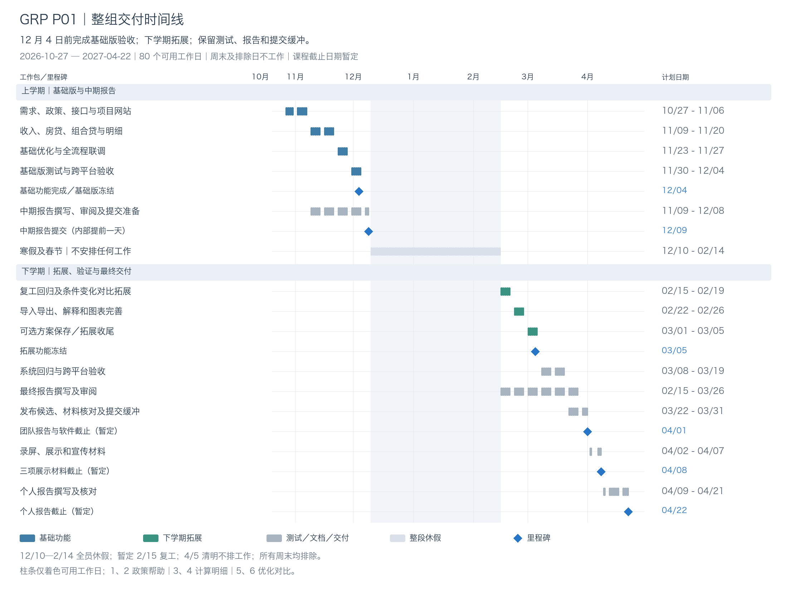

# GRP P01 整组时间线：基础版、中期报告与下学期拓展

编制日期：**2026 年 10 月 25 日**。项目开始：**2026 年 10 月 27 日（下周二）**。所有时间按 Asia/Shanghai。

## 1. 阶段目标

| 阶段 | 起止日期 | 必须达到的状态 |
|---|---|---|
| 基础功能开发与验收 | 2026-10-27—2026-12-04 | 完成并验收全部题目必做功能，形成可运行基础版；12/4 冻结基础版。 |
| 中期报告定稿与提交 | 2026-12-07—2026-12-09 | 报告描述已实现、已验证的基础版；12/9 提交并归档。报告章节在 11 月开发期间同步撰写。 |
| 寒假及春节休假 | 2026-12-10—2027-02-14 | 全员休假，不安排开发、会议、审阅、报告或提交。 |
| 下学期功能拓展 | 2027-02-15—2027-03-05 | 回归基础版后完善条件对比、导入导出、推荐解释及图表；有余力再加方案保存；3/5 功能范围冻结。 |
| 系统验证、最终报告与软件交付 | 2027-03-08—2027-04-01 | 完成回归、跨平台验收、报告和发布候选；3/31 为内部提交目标，4/1 为附件暂定截止日。 |
| 展示材料与个人报告 | 2027-04-02—2027-04-22 | 完成演示、展示、宣传作品和个人报告；软件提交后不再安排新增功能。 |

已有 prototype 是开发起点。对现有功能安排代码理解、独立核对、界面整理和测试；已有拓展功能可以保留，但不能挤占基础版和中期报告的工作时间。以下全部为计划安排，不代表未来工作已经完成。

## 2. 上学期基础版与下学期拓展的边界

**12 月 4 日前必须完成并验收：**

1. 收入与税务：工资、奖金、扣除、社保和公积金输入，计算税后收入；注明支持的政策范围和计算口径。
2. 房贷：商业贷款、公积金贷款及组合贷；等额本息和等额本金；月供、总利息及完整还款计划。
3. 联合现金流：月度及年度收入、税费、还款和可支配现金；明细与摘要能核对。
4. **约束优化：**在用户允许的贷款年限、贷款组合等范围内搜索；按一个定义清楚的目标推荐；与原方案比较；解释无可行方案；可应用推荐参数。该项是题目必做功能，必须在中期报告前完成。
5. 可使用的界面：联合计算、账单明细、基础优化、政策和帮助；基本图表；中英文、输入校验和错误反馈；实际电脑与手机走通流程。
6. 工程交付：本地网址可访问、启动说明、核心计算测试、基础接口与页面检查、政策来源、测试记录和中期报告材料。

**下学期安排的拓展：**

- 独立的条件变化对比页：固定基准，调整利率或年限等一个条件，展示结果变化。
- 更完整的推荐理由、指标取舍和对比图表；基础版已经具备原方案比较。
- CSV 明细导出、JSON 方案导入导出的完整体验与往返校验；若现有实现已可用则重点核对和改善。
- 政策版本追溯、更多操作示例、双语和手机布局完善。
- **可选：**用 PostgreSQL 保存、命名、重新载入方案。仅在前述任务完成后开展，3/5 未完成则移出本期。

最终仍为六个页面。条件变化对比作为下学期拓展重点；上学期不会以占位页或未实现按钮充当已完成功能。多城市、账号系统、实时银行数据和复杂预测不纳入承诺范围。

## 3. 整组分工与验收责任

| 成员 | 负责工作 | 上学期重点 | 下学期重点 |
|---|---|---|---|
| 1 | 项目经理、业务分析、辅助后端；与 2 负责政策和帮助 | 审阅进度及交付，核对需求覆盖；政策和示例接口、来源及规则；检查中期报告与软件是否一致。 | 核对政策变更、拓展范围、报告及演示材料；辅助政策追溯和后端校验。 |
| 2 | 前端、UI、业务分析；与 1 负责政策和帮助 | 政策与帮助页面、双语说明、课程项目网站内容；与 1 共同核对业务规则。 | 更新拓展操作指南、政策说明和示例；检查双语、布局及来源链接。 |
| 3 | 后端；与 4 负责计算和明细 | Java/BigDecimal 计算、完整还款计划、现金流和 JUnit 测试。 | 支持导入导出数据契约、政策版本追溯、回归及发布验证。 |
| 4 | 前端、UI；与 3 负责计算和明细 | 计算表单、结果、明细、公共导航和布局；基础双语及跨平台流程。 | CSV/JSON 交互、图表完善、手机和错误状态检查、端到端回归。 |
| 5 | 后端；与 6 负责优化和对比 | 必做约束优化、排序、推荐与应用接口；数据库配置、Docker 和 CI 基础。 | 条件对比和解释；有余力再做方案保存；集成测试和最终发布。 |
| 6 | 前端、UI；与 5 负责优化和对比 | 优化设置、推荐、原方案比较、无解提示及应用方案。 | 独立条件对比页、推荐解释和图表；可选方案保存交互；页面测试。 |

每个人完成自己的模块测试、文档和报告章节。成员 1 的项目管理以**审阅、核对、记录问题和复核修改**为主；后端代码由成员 3、5 交叉检查，前端由成员 2、4、6 交叉检查。

## 4. 日历、假期与课程日期

- 排除全部周六、周日；法定调休补班的周末也不安排学生项目任务。
- 12/9 中期报告提交后，**12/10—2/14 整段休假**。不留下 12/10 上传报告的任务；须在放假前确认提前提交渠道。
- **2/15 复工为暂定项目安排。**截至编制日检索未找到正式完整的 2027 年国务院放假安排；中国货币网的预设日历将春节设为 2/5—2/12，清明为 4/5，并明确需等待正式通知调整。[预设日历来源](https://www.chinamoney.org.cn/chinese/bbjjr/20251219/3254570.html)
- 4/5 清明不安排工作；4/3、4/4 已为周末。元旦和春节均被整段休假覆盖。2026 年本项目开始后的全国节假日排除依据沿用已核对的[国务院 2026 年安排](https://big5.www.gov.cn/gate/big5/www.gov.cn/zhengce/content/202511/content_7047090.htm)。
- 官方 2027 年安排或校历确认后，成员 1、2 再核对：新增放假工作日全部扣除，优先减少可选拓展，不将任务挪到假期或周末。
- 附件课程日期均为 **TENTATIVE/TBC**：伦理材料 10/28；项目网站 11/5；中期报告课程暂定 12/10，本组提前至 **12/9**；团队报告与软件 **2027/4/1**；演示录屏、团队展示录屏及宣传数字作品 **4/8**；个人报告 **4/22**。附件给出的上述截止时间均为 15:00，内部提前提交安排除外。
- Open Day、一分钟介绍和现场问答日期待确认；只预留材料准备，不编造出席日期。

按当前暂定日历，共 **80 个可用工作日**：休假前 **32 天**，复工后 **48 天**；其中 **29 天**用于 12/4 前基础版工作，**3 天**用于中期报告定稿及提交缓冲。4/1 及以前共 **66 个可用工作日**，之后用于展示和个人报告。

这些数字表示日历容量，**不等于全职人日或每人工作小时**。标准周可暂按每人 8 小时课外投入规划，包含开发、审查、测试、会议和文档；短周按比例减少，假期为零。周内采用并行分工，不要求全员按顺序等待同一模块。

## 5. 详细时间线

<!-- TIMELINE_TABLE -->

| 阶段 | 开始日期 | 结束日期 | 工作日 | 负责人 | 具体任务 | 交付／验收 |
|---|---|---|---:|---|---|---|
| 01. **启动、需求与政策范围** | 2026-10-27 | 2026-10-30 | 4 | 全员；1、2 核对需求 | 每人启动现有 prototype；1、2 确认适用地区、年份和规则来源；3、5 确认计算接口；2、4、6 确认页面布局。核对 10/28 暂定伦理材料截止要求。 | 可运行基线、需求清单、责任分工及政策来源表。 |
| 02. **数据模型、接口与项目网站** | 2026-11-02 | 2026-11-06 | 5 | 1、2 政策帮助；3、4 计算；5、6 优化 | 1 建政策和示例数据结构，2 完成说明页初版；3 建计算输入输出，4 完成表单与公共导航；5、6 用模拟数据接通优化页。11/5 前完成课程项目网站要求，各自开始写需求与设计说明。 | 接口样例、页面框架、项目网站与需求追踪表。 |
| 03. **工资、个税与公积金基础计算** | 2026-11-09 | 2026-11-13 | 5 | 3、4 主责；1、2 核对；5、6 并行开发 | 3 实现或复核工资、奖金、扣除、社保和公积金；4 联调收入结果；1、2 补齐来源、字段说明及参考案例；5、6 开发优化参数和候选生成。全员持续写中期报告自己的章节。 | 收入计算可演示；参考案例、边界测试和报告设计章节初稿。 |
| 04. **房贷、组合贷与账单明细** | 2026-11-16 | 2026-11-20 | 5 | 3、4 主责；5 交叉检查；1、2 政策 | 3、4 接通等额本息、等额本金、组合贷、年度现金流和完整还款明细；5 复用计算模块接入约束；6 完成优化结果展示；1、2 完成基础政策与帮助页面。 | 两种还款方式及组合贷可用，首页与账单总额一致，说明页面可读。 |
| 05. **基础优化与全流程联调** | 2026-11-23 | 2026-11-27 | 5 | 5、6 主责；3、4 联调；1、2 规则验收 | 完成年限、贷款组合等允许变量的有界搜索、约束过滤、推荐排序、原方案比较及应用方案；处理无可行方案；核对输入—计算—推荐—明细完整流程。 | 必做优化功能完成；小候选集有独立预期结果；推荐可复现。 |
| 06. **基础版验收与中期报告审阅** | 2026-11-30 | 2026-12-04 | 5 | 全员；1 审阅核对；3、5 后端；2、4、6 前端 | 检查所有必做功能、双语、本地启动及至少一台真实电脑和一台真实手机；回归金额、接口和页面流程；修复阻断问题。每人完成自己的报告章节，1 核对报告、截图和软件版本。 | 12/4 基础版验收并冻结，报告完整草稿及实际测试记录就绪。 |
| 07. **报告定稿、提交与休假归档** | 2026-12-07 | 2026-12-09 | 3 | 全员完成材料；1 审阅核对 | 仅做必要修复、引用和格式检查；12/9 提交中期报告并确认回执；归档基础版、演示输入、测试和复工说明。提前确认报告能在课程暂定 12/10 截止前一天提交。 | 中期报告已提交；基础功能及归档材料完整；假期无遗留提交任务。 |
| 08. **寒假及春节休假** | 2026-12-10 | 2027-02-14 | 0 | 全员休假 | 不安排开发、会议、审阅、报告或提交；暂定春节后 2/15 复工。 | 工作日容量为 0；无任何任务依赖假期投入。 |
| 09. **复工检查与条件对比拓展** | 2027-02-15 | 2027-02-19 | 5 | 1、2 核对；3、4 回归；5、6 拓展 | 先恢复冻结版本并回归，核对政策、校历和截止日期；5、6 扩展独立条件变化对比页，支持固定基准改变一个参数。开始撰写最终报告增量章节；本周不预留首次完成必做功能。 | 基础版回归通过；条件对比首版可演示；仅已确认的拓展进入任务清单。 |
| 10. **导入导出、解释与图表拓展** | 2027-02-22 | 2027-02-26 | 5 | 3、4 明细及导入导出；5、6 推荐；1、2 帮助 | 3、4 完善 CSV 明细导出和 JSON 方案往返；5、6 完善推荐差额解释、条件对比图及不可行提示；1、2 更新政策追溯和帮助示例。 | 导出数据一致，导入可重算；图表与原始数据一致；六个最终页面全部贯通。 |
| 11. **拓展收尾与功能范围冻结** | 2027-03-01 | 2027-03-05 | 5 | 全员；5、6 可选保存；1、2 内容；3、4 稳定性 | 仅在前述拓展通过后考虑 PostgreSQL 命名方案保存，由 5、6 实现，3、4 提供方案数据，1 辅助；其余成员完善双语、手机及说明。3/5 冻结功能，未完成可选项移出本期。 | 拓展完成并冻结，方案保存明确标注完成或取消，后续只做测试修复。 |
| 12. **系统集成与回归测试** | 2027-03-08 | 2027-03-12 | 5 | 3、5 后端；2、4、6 前端；1 覆盖核对 | 执行 JUnit、Spring Boot 集成测试和 Playwright 关键流程；检查异常输入、无解、双语和导入导出；验证数据库、Docker 与 CI 的实际运行情况。 | 需求—测试追踪表、真实测试结果和缺陷修复记录。 |
| 13. **跨平台验收与最终报告初稿** | 2027-03-15 | 2027-03-19 | 5 | 全员完成自己的章节；1 审阅核对 | 在真实电脑和手机完成典型操作，修复可用性问题；完成需求、设计、实现、测试、限制及贡献章节。1 核对报告与软件结果、截图和版本。 | 跨平台验收记录及 3/19 最终报告完整初稿。 |
| 14. **发布候选、报告终审与展示准备** | 2027-03-22 | 2027-03-26 | 5 | 3、5 发布；2、4、6 展示；1 审阅 | 从干净环境验证启动，回归关键计算，核对政策引用、用户手册和贡献记录；准备演示脚本、PPT 和宣传材料初稿；3/26 冻结提交候选版。 | 可运行发布候选、终审报告和展示材料初稿，关键缺陷关闭。 |
| 15. **最终检查与提交缓冲** | 2027-03-29 | 2027-03-31 | 3 | 全员；1 核对交付清单 | 保留三天用于必要返工、打包、格式和上传检查；内部目标 3/31 提交团队报告和软件，若系统未开放则全部材料提前就绪。 | 软件、报告、配置和证据版本一致，提交回执或待上传完整包就绪。 |
| 16. **团队报告与软件提交截止** | 2027-04-01 | 2027-04-01 | 1 | 全员；1 核对完成情况 | 15:00 前完成或核对提交，下载检查所交文件，保存回执；附件日期仍为暂定。 | 团队报告与软件提交完成。 |
| 17. **演示及团队展示录制** | 2027-04-02 | 2027-04-02 | 1 | 全员；2、4、6 画面；3、5 技术演示；1 核对 | 按已准备脚本录制提交版本；制作宣传数字作品；不再增加软件功能。 | 两份录制初稿和宣传作品初稿。 |
| 18. **录制材料检查与提前提交** | 2027-04-06 | 2027-04-07 | 2 | 全员；1 审阅完整性 | 4/3—4/5 不工作；4/6 起检查声音、字幕、时长、播放及链接，目标 4/7 提交三项材料。 | 三项展示材料通过检查并准备好或完成提交。 |
| 19. **录屏、展示及宣传材料截止** | 2027-04-08 | 2027-04-08 | 1 | 全员核对 | 15:00 前核对软件演示录屏、团队展示录屏和宣传数字作品提交及回执；日期暂定。 | 三项材料提交完成。 |
| 20. **个人报告提纲与答辩素材** | 2027-04-09 | 2027-04-09 | 1 | 每人负责自己的报告 | 整理本人真实贡献、技术决策和证据；准备一分钟介绍和问答素材。Open Day 与现场问答实际日期另行确认。 | 六份个人提纲与贡献证据清单。 |
| 21. **个人报告撰写** | 2027-04-12 | 2027-04-16 | 5 | 每人独立撰写 | 完成个人实现、问题解决、测试、协作和反思；同伴可检查事实和引用。 | 六份个人报告完整初稿。 |
| 22. **个人报告终审与缓冲** | 2027-04-19 | 2027-04-21 | 3 | 每人负责自己的提交 | 核对格式、引用、贡献及课程要求的 AI 使用说明；内部目标 4/21 提交。 | 六份个人报告终稿及提交准备。 |
| 23. **个人报告提交截止** | 2027-04-22 | 2027-04-22 | 1 | 每人提交；1 核对完成状态 | 15:00 前核对或完成提交并保存回执；未定日期活动继续标记待确认。 | 所有已知书面和数字材料提交归档。 |

<!-- /TIMELINE_TABLE -->

每行是一段整组工作窗口，窗口内三组成员并行开发、审查和写作，负责人列给出当期重点。工作日数含起止日期并扣除排除日；阶段覆盖全部可用工作日且不重复计数。甘特图中的报告长条是同步进行的工作，不额外增加日历容量。

## 6. 甘特图

[查看矢量 SVG](assets/grp_delivery_timeline_zh.svg)。蓝色为基础功能，绿色为下学期拓展，灰色为测试、文档和交付，菱形为里程碑。工作条只着色可用工作日；整段休假使用单独背景标记。

## 7. 每个阶段如何收尾

- **基础版验收（12/4）：**用固定演示输入走通计算、组合贷、推荐及明细；独立参考案例和回归通过；真实电脑及手机可用；每个必做需求对应实现、测试和演示步骤。
- **中期报告（12/9）：**每人提交自己的章节和证据，成员 1 审阅核对；明确当前已完成内容、适用政策和限制，拓展写入下学期计划。
- **拓展冻结（3/5）：**检查数据导入导出、条件对比与推荐解释；未完成的可选方案保存撤出范围；冻结后安排验证与必要修复。
- **团队报告与软件（内部目标 3/31，课程暂定 4/1）：**报告、源码、运行包、截图、政策版本和测试结果一致；干净环境能按说明启动；记录实际验证的平台。
- **展示材料（内部目标 4/7，课程暂定 4/8）：**提交演示录屏、团队展示录屏及宣传数字作品；演示的是正式提交的软件版本。
- **个人报告（内部目标 4/21，课程暂定 4/22）：**本人撰写，依据真实代码和贡献；核对引用、课程格式及要求的 AI 使用说明。

如果基础版在验收前出现计算或集成问题，立即减少界面装饰和可选内容，优先修复必做功能；不把尚未完成的基础要求改称下学期拓展。项目材料中的“已实现”和“已测试”必须与实际状态一致。
